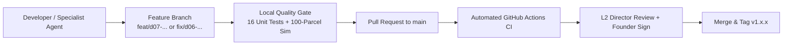

# CONTRIBUTING TO YANTRIK DWS-S01

## 1. ENGINEERING POSTURE & WORKFLOW

YANTRIK DWS-S01 is a proprietary commercial industrial product engineered by YANTRIK. All development is conducted by the YANTRIK AI Workforce under the direction of the Human Founder (Level 4 Sovereign Authority).



---

## 2. PULL REQUEST CHECKLIST

Before submitting any code changes to `yantrik-dws`:

1. **Unit Test Gate:** All 16 unit tests must pass cleanly:
   ```bash
   python3 tests/test_dws_pipeline.py
   ```
2. **Simulation Stress Benchmark:** 100/100 synthetic parcels must achieve 100% Legal Metrology pass rate with average latency $< 5\text{ms}$:
   ```bash
   python3 tests/simulators/run_e2e_simulation.py
   ```
3. **Founder Hands-Off Rule:** Any changes affecting optical clearance or scale filtering must strictly preserve:
   - Overhead vision detection of hands or periphery touches (`HOLD_HAND_DETECTED`).
   - 5-sample weight stability evaluation ($\le 10\text{g}$ fluctuation).
4. **Zero Third-Party Dependency Guarantee:** The edge server and operator HMI must continue to run out-of-the-box on Python 3.10+ standard library without requiring external pip packages.
