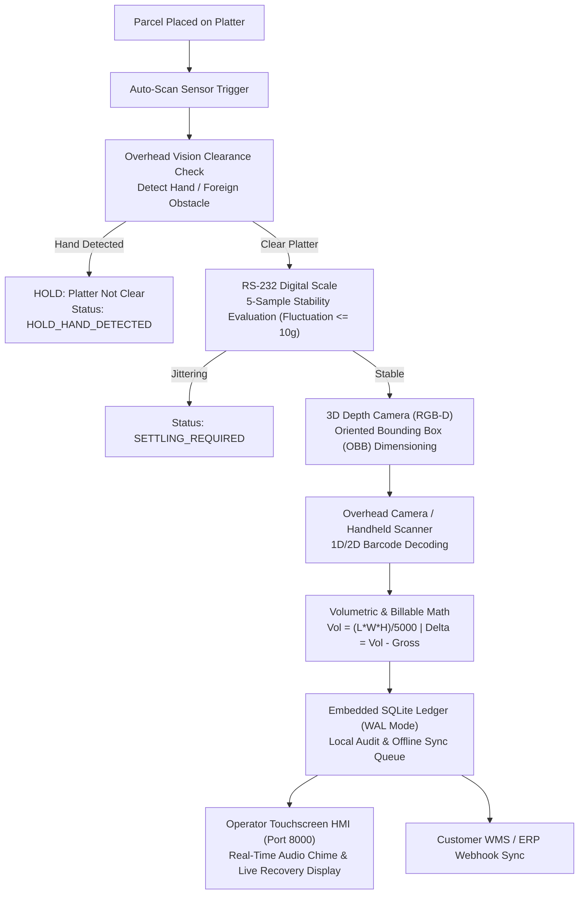

# YANTRIK DWS-S01 — Static Dimensioning, Weighing & Scanning Workstation

[](https://github.com/Tushar-CodeSpace/yantrik-dws/actions)
[](https://www.python.org/)
[](https://sqlite.org/)
[](LICENSE)

The **YANTRIK DWS-S01** is an industrial-grade, static tabletop Dimensioning, Weighing, and Barcode Scanning (DWS) workstation engineered for express logistics hubs, 3PL dispatch cross-docks, and e-commerce fulfillment centers. 

It captures legal-for-trade parcel dimensions, certified gross weight, and 1D/2D barcodes in under **$< 2.0\text{ seconds}$**, calculating real-time volumetric weight and recovering lost freight revenue caused by manual under-declaration.

---

## 1. SYSTEM TOPOLOGY & WORKFLOW



---

## 2. KEY SPECIFICATIONS

| Parameter | Specification | Metrology Standard |
| :--- | :--- | :--- |
| **Measurement Envelope** | $100\text{mm} \times 100\text{mm} \times 50\text{mm}$ to $800\text{mm} \times 600\text{mm} \times 600\text{mm}$ | OIML R129 / Legal Metrology |
| **Dimension Accuracy** | $\pm 5\text{mm}$ ($\pm 0.5\text{cm}$) | Legal Metrology Certified |
| **Weight Capacity** | $0.100\text{kg}$ to $60.000\text{kg}$ (Resolution: $10\text{g}$) | OIML R51 Class III |
| **Weight Stability Rule** | 5 consecutive readings with fluctuation $\le 10\text{g}$ | Founder Hands-Off Standard |
| **Throughput Speed** | $600 - 900$ parcels / hour ($< 2.0\text{s}$ total cycle time) | Industrial Static Workstation |
| **Optical Clearance** | Automatic pause if operator hand is detected on platter | Founder Hands-Off Standard |
| **Volumetric Divisor** | $5000\text{ cm}^3/\text{kg}$ (Configurable: 4000, 6000) | IATA Logistics Standard |
| **Platter Surface** | Stainless Steel 304 ($800\text{mm} \times 600\text{mm}$) | Heavy-Duty Industrial |
| **Edge Compute** | Quad-core x86-64 / ARM64 Ubuntu Server LTS | Zero pip dependency default |
| **Embedded Database** | SQLite with Write-Ahead Logging (WAL) | Multi-year offline resilience |

---

## 3. REPOSITORY DIRECTORY TAXONOMY

```
yantrik-dws/
├── README.md                          # Master product overview & quickstart
├── LICENSE                            # YANTRIK proprietary commercial license
├── CONTRIBUTING.md                    # Engineering contribution standards
├── SECURITY.md                        # Industrial edge security guidelines
├── pyproject.toml                     # Python package build manifest
├── requirements.txt                   # Hardware driver dependencies (optional)
├── launch_yantrik_dws.sh              # One-click desktop launcher
├── YANTRIK_DWS.desktop                # Linux desktop application entry
├── Dockerfile                         # Containerized edge appliance image
├── docker-compose.yml                 # Local edge runtime compose configuration
│
├── .github/
│   └── workflows/
│       └── ci.yml                     # Automated unit test and simulation pipeline
│
├── src/
│   └── yantrik_dws/
│       ├── __init__.py                # Package version 1.1.0
│       ├── server.py                  # Zero-dependency embedded edge HTTP server
│       ├── models.py                  # Domain models (ParcelRecord, Dimensions, Weight)
│       ├── drivers/
│       │   ├── scale_serial.py        # RS-232 scale driver with 5-sample 10g filter
│       │   └── plc_modbus.py          # Modbus TCP/IP client (Siemens/Delta)
│       ├── vision/
│       │   ├── dimensioner.py         # 3D point cloud OBB dimensioner & optical clearance
│       │   └── barcode_scanner.py     # 1D/2D omni-directional barcode scanner
│       ├── database/
│       │   └── sqlite_manager.py      # SQLite WAL audit ledger & recovery analytics
│       ├── services/
│       │   └── event_orchestrator.py  # Dual-gating measurement orchestrator
│       └── ui/
│           └── index.html             # Industrial touchscreen dark-mode HMI
│
├── hardware/
│   ├── cad/
│   │   └── STATIC_FRAME_SPEC.md       # 4040/4080 extrusion specs & mast deflection math
│   ├── electrical/
│   │   └── ELECTRICAL_SCHEMATICS.md   # 24VDC loop, E-Stop, DIN rail wiring schedule
│   ├── plc/
│   │   └── dws_state_machine.scl      # IEC 61131-3 Structured Text PLC state machine
│   └── bom/
│       └── UNIT_COST_MODEL.md         # COGS unit cost breakdown & margins
│
├── specs/
│   ├── PRD.md                         # Master Product Requirements Document
│   ├── ARCHITECTURE.md                # System Topology & Subsystems Architecture
│   ├── METROLOGY_COMPLIANCE.md        # Legal Metrology OIML R51 / R129 Certification
│   └── INTERFACE_CONTRACTS.md         # Serial, Modbus, and JSON schemas
│
└── tests/
    ├── test_dws_pipeline.py           # 16-test comprehensive unit test suite
    └── simulators/
        ├── mock_scale.py              # Virtual RS-232 serial scale simulator
        └── run_e2e_simulation.py      # 100-parcel stress test benchmark harness
```

---

## 4. QUICKSTART & LOCAL VERIFICATION

The entire system is designed to run **out-of-the-box on standard Python 3.10+ without installing any third-party pip packages**.

### Step 1: Run Core Pipeline Unit Tests
```bash
python3 tests/test_dws_pipeline.py
# Executes 16 unit tests: scale parsing, 5-sample stability, optical clearance, SQLite WAL
```

### Step 2: Run the 100-Parcel Simulation Stress Harness
```bash
python3 tests/simulators/run_e2e_simulation.py
# Benchmarks 100 synthetic parcels through the pipeline (100% Legal Metrology pass rate)
```

### Step 3: Launch the Operator Touchscreen HMI
```bash
./launch_yantrik_dws.sh
# Starts background edge server on port 8000 and opens http://localhost:8000/
```
Or start manually:
```bash
python3 src/yantrik_dws/server.py
```

---

## 5. REST API SPECIFICATION

The embedded edge server exposes standard REST APIs for ERP/WMS integration:

| Method | Endpoint | Description |
| :--- | :--- | :--- |
| `GET` | `/` | Serves the interactive Touchscreen Operator HMI |
| `GET` | `/api/v1/health` | Edge appliance health status, DB engine, record count |
| `GET` | `/api/v1/summary` | Daily throughput, recovered volumetric kg, revenue recovered (₹) |
| `GET` | `/api/v1/parcels` | Returns the 25 most recent parcel scans |
| `POST` | `/api/v1/scan` | Submits a parcel scan with dimensions, scale weight, and barcode |

---

## 6. DOCKER & EDGE DEPLOYMENT

To deploy as a containerized edge appliance on Ubuntu Server LTS:

```bash
docker compose up -d --build
```
Check health:
```bash
curl http://localhost:8000/api/v1/health
```

---

## 7. MAINTENANCE & OWNERSHIP

- **Department Owner:** D09 DevOps & Infrastructure (`AGT-D09-DIR`) in coordination with D07 Software Engineering (`AGT-D07-DIR`).
- **Parent Repository:** [`company-os`](https://github.com/Tushar-CodeSpace/yantrik) (Enterprise Governance, Commercial Strategy, and Workforce Directory).
- **Maintenance Runbook:** Referenced in [`departments/devops-infrastructure/DWS_REPO_MAINTENANCE_RUNBOOK.md`](file:///home/snyder/yantrik/departments/devops-infrastructure/DWS_REPO_MAINTENANCE_RUNBOOK.md).

---

## 8. PROPRIETARY NOTICE & COMMERCIAL TERMS

This software and hardware specification is the confidential, proprietary intellectual property of **YANTRIK**. Commercial pilots require a formal Master Pilot Agreement and a mandatory **50% upfront PO advance**.

Inquiries: `founder@yantrik.internal` | `legal@yantrik.internal`
