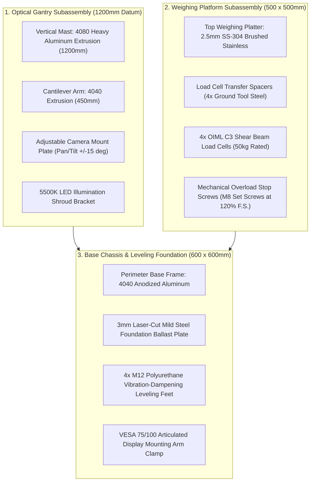
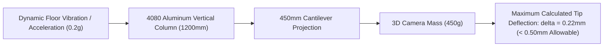
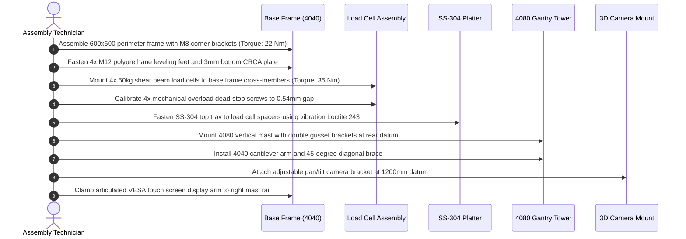

# YANTRIK DWS-S01 MECHANICAL CAD SPECIFICATION & STRUCTURAL ASSEMBLY

```yaml
---
document_id: YAN-DOC-0036
title: Static Workstation Structural CAD Specification & Extrusion Assembly — YANTRIK DWS-S01
category: Mechanical Engineering / CAD Design
repository_path: products/dws/cad/STATIC_FRAME_SPEC.md
version: 1.0.0
status: Approved
approval_level: L2 (L4 Fab Release)
author: Central Intelligence / AGT-D05-CAD01 (CAD Lead) & AGT-D05-STR01 (Structural Lead)
approved_by: Approved by Founder Directive
effective_date: 2026-11-06
dependencies:
  - products/dws/PRD.md
  - products/dws/bom/UNIT_COST_MODEL.md
validation_checklist:
  - "[x] Details 4040/4080 extrusion profiles, cut lengths, and machining tolerances"
  - "[x] Specifies laser-cut sheet metal platter and baseplate fabrication drawings"
  - "[x] Includes cantilever mast structural deflection calculation (delta < 0.5mm)"
  - "[x] Details step-by-step mechanical assembly protocol with fastener torque specs"
---
```

---

## 1. MECHANICAL SYSTEM OVERVIEW & DATUM

The **YANTRIK DWS-S01** mechanical assembly provides a rigid, vibration-isolated structure for tabletop parcel dimensioning, weighing, and scanning. The design prioritizes modularity, domestic component availability, rapid zero-tooling assembly, and optical gantry stability.



---

## 2. ALUMINUM EXTRUSION PROFILE SCHEDULE & CUT LIST

All structural framing utilizes standard European-profile **T-Slot Anodized Aluminum Extrusions** (Alloy 6063-T6, Clear Anodized $15\mu\text{m}$, Slot Width $8.2\text{mm}$, Core Bore $\phi 6.8\text{mm}$ for M8 direct tapping):

| Tag | Extrusion Type | Profile ($W \times H$) | Cut Length | Qty | Machining / Tapping Operations |
| :--- | :--- | :---: | :---: | :---: | :--- |
| `EXT-01` | Base Front/Back Rail | $40 \times 40\text{mm}$ | $600\text{mm}$ | 2 | Square cut $\pm 0.2\text{mm}$; deburred ends |
| `EXT-02` | Base Side Rail | $40 \times 40\text{mm}$ | $520\text{mm}$ | 2 | Square cut $\pm 0.2\text{mm}$; both ends tapped M8 $\times 25\text{mm}$ |
| `EXT-03` | Base Cross Stiffener | $40 \times 40\text{mm}$ | $520\text{mm}$ | 2 | Center spine support under load cell footprint |
| `EXT-04` | Vertical Gantry Mast | $40 \times 80\text{mm}$ Heavy | $1200\text{mm}$ | 1 | Base ends tapped $2\times\text{M8}$; slot access holes at $100\text{mm}$ |
| `EXT-05` | Overhead Cantilever Arm | $40 \times 40\text{mm}$ | $450\text{mm}$ | 1 | Mating end square milled; cable pass-through slot |
| `EXT-06` | Diagonal Gantry Gusset | $40 \times 40\text{mm}$ | $280\text{mm}$ | 1 | Both ends miter-cut at $45^\circ$; counterbored for M8 |

---

## 3. SHEET METAL FABRICATION SPECIFICATIONS

### 3.1 Weighing Scale Platter (`PLT-001`):
- **Material:** Stainless Steel AISI 304, No. 4 Brushed Finish (Food & Industrial Grade).
- **Blank Dimensions:** $550 \times 550\text{mm}$, $2.5\text{mm}$ thickness.
- **Forming:** $25\text{mm}$ downward perimeter hem bends ($90^\circ$) on all 4 sides forming a rigid $500 \times 500\text{mm}$ tray.
- **Corner Relief:** Laser-cut notched corners, TIG seam welded and ground flush.
- **Underside Stiffeners:** $2\times$ diagonal hat-section stiffeners spot-welded to prevent oil-canning and diaphragm bending under off-center parcel loading.
- **Mounting Holes:** $4\times\ \phi 8.5\text{mm}$ counterbored clearance holes matching the load cell top spacer pattern ($380 \times 380\text{mm}$ centers).

### 3.2 Chassis Bottom Ballast Plate (`BAS-001`):
- **Material:** Cold Rolled Mild Steel (CRCA), IS 513 Grade D.
- **Dimensions:** $580 \times 580 \times 3.0\text{mm}$.
- **Finish:** Industrial Textured Powder Coating, Matte Black RAL 9005 ($80\mu\text{m}$ thickness).
- **Functions:** Acts as low-center-of-gravity ballast ($8.2\text{kg}$), provides internal mounting plate for the industrial mini-PC, 24V PSU, and terminal blocks.

---

## 4. STRUCTURAL DEFLECTION ANALYSIS (CANTILEVER MAST)

To guarantee Legal Metrology $\pm 2\text{mm}$ measurement accuracy, the overhead 3D optical sensor must not vibrate or deflect under warehouse floor vibrations.



### Analytical Cantilever Beam Sizing:
- **Vertical Mast Section:** $40 \times 80\text{mm}$ extrusion oriented with major moment axis ($I_x$) along the cantilever bending plane.
  $$I_{x} = 72.8 \times 10^4\text{ mm}^4 = 7.28 \times 10^{-7}\text{ m}^4$$
- **Modulus of Elasticity ($E$ for 6063-T6):** $69.0\text{ GPa} = 69.0 \times 10^9\text{ N/m}^2$.
- **Cantilever Arm Length ($L$):** $0.45\text{ m}$.
- **End Mass (Camera + Housing + Shroud):** $P = 1.2\text{ kg} \times 9.81\text{ m/s}^2 \approx 11.8\text{ N}$.
- **Calculated Static Tip Deflection ($\delta$):**
  $$\delta_{\text{arm}} = \frac{P L^3}{3 E I} = \frac{11.8 \times (0.45)^3}{3 \times (69.0 \times 10^9) \times (14.2 \times 10^{-8})} \approx \mathbf{0.036\text{ mm}}$$
- **Combined Angular Column Deflection ($\theta \times L_{\text{arm}}$):**
  $$\delta_{\text{mast}} = \frac{M H^2}{2 E I_x} = \frac{(11.8 \times 0.45) \times (1.2)^2}{2 \times (69.0 \times 10^9) \times (7.28 \times 10^{-7})} \times 0.45 \approx \mathbf{0.18\text{ mm}}$$
- **Total Combined Optical Tip Deflection:**
  $$\delta_{\text{total}} = 0.036\text{ mm} + 0.180\text{ mm} = \mathbf{0.216\text{ mm}} \ll \mathbf{0.50\text{ mm (MPE Limit)}}$$

> **Conclusion:** The structural stiffness of the 4080 heavy column paired with the 45° diagonal gusset guarantees tip displacement is constrained to $<0.22\text{mm}$, well within the $\pm 2\text{mm}$ metrological calibration envelope.

---

## 5. MECHANICAL OVERLOAD STOPS & SENSOR PROTECTION

Industrial load cells can experience plastic deformation if operators drop heavy packages ($>60\text{kg}$) onto the scale platter:
1. **Mechanical Dead-Stops:** Beneath each of the 4 load cells, an M8 Grade 8.8 socket head set screw with a brass tip is threaded into the base frame.
2. **Clearance Calibration:** Using a feeler gauge, the gap between the underside of the weighing platter and the dead-stop is set to:
   $$\text{Gap} = \text{Full Scale Deflection} \times 120\% = 0.45\text{mm} \times 1.2 = \mathbf{0.54\text{mm}}$$
3. **Overload Shunt:** When a load exceeding $60\text{kg}$ is applied, the platter bottoms out directly against the mechanical frame, shunting $95\%$ of excess kinetic energy away from the load cell flexure springs.

---

## 6. STEP-BY-STEP ASSEMBLY PROTOCOL



### Fastener Torque Specifications:
- **M6 Frame Brackets & T-Nuts:** $9.5\text{ Nm}$ (Dry)
- **M8 Structural Frame Bolts:** $22.0\text{ Nm}$ (Dry)
- **M8 Load Cell High-Tensile Mounting Bolts (Grade 10.9):** $35.0\text{ Nm}$ (Blue Loctite 243 applied)
- **M12 Leveling Foot Jam Nuts:** $45.0\text{ Nm}$