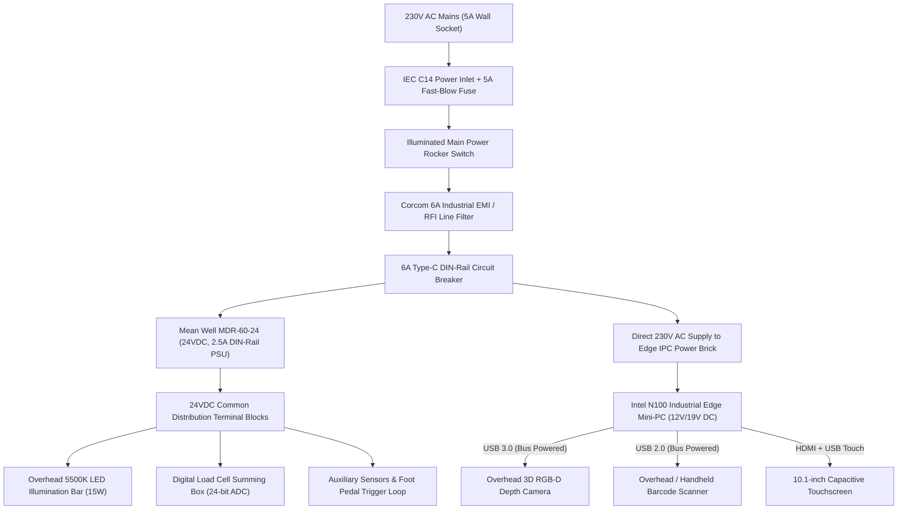
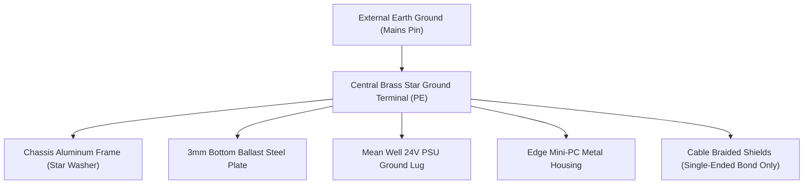

# YANTRIK DWS-S01 ELECTRICAL POWER DISTRIBUTION & CONTROL SCHEMATICS

```yaml
---
document_id: YAN-DOC-0037
title: Electrical Power Distribution, Control Panel Schematics & Safety Interlocks — YANTRIK DWS-S01
category: Electrical & Automation / Schematics
repository_path: products/dws/electrical/ELECTRICAL_SCHEMATICS.md
version: 1.0.0
status: Approved
approval_level: L2 (L4 Safety Release)
author: Central Intelligence / AGT-D06-ELE01 (Electrical Lead) & AGT-L1-CTO (Chief Technology Agent)
approved_by: Approved by Founder Directive
effective_date: 2026-11-06
dependencies:
  - products/dws/PRD.md
  - products/dws/ARCHITECTURE.md
  - products/dws/bom/UNIT_COST_MODEL.md
validation_checklist:
  - "[x] Details 230VAC single-phase power distribution with EMI line filtration"
  - "[x] Maps 24VDC instrument power loop, terminal blocks, and wire schedule"
  - "[x] Details star-grounding architecture to prevent 50Hz load-cell noise"
  - "[x] Outlines hardwired Category 3 E-Stop safety circuit per ISO 13849-1"
---
```

---

## 1. ELECTRICAL ARCHITECTURE OVERVIEW

The **YANTRIK DWS-S01** electrical system is engineered for industrial resilience, high noise immunity, and maximum operator safety. It runs on standard single-phase mains power ($230\text{V AC} \pm 10\%$, $50\text{Hz}$) with total peak power consumption under $120\text{W}$.



---

## 2. POWER DISTRIBUTION & WIRE SCHEDULE

### 2.1 Wire Gauge & Color Code Standards:
- **AC Phase ($L$):** $1.0\text{ mm}^2$ (18 AWG), **Brown / Red** insulation.
- **AC Neutral ($N$):** $1.0\text{ mm}^2$ (18 AWG), **Blue / Black** insulation.
- **Protective Earth ($PE$):** $1.5\text{ mm}^2$ (16 AWG), **Green with Yellow Stripe**.
- **DC Positive ($+24\text{V}$):** $0.75\text{ mm}^2$ (20 AWG), **Solid Red / Orange**.
- **DC Negative ($0\text{V} / \text{GND}$):** $0.75\text{ mm}^2$ (20 AWG), **Solid Dark Blue / White**.
- **Analog / Serial Data:** Multi-core shielded twisted pair (STP), foil shield + tinned copper braid.

### 2.2 DIN-Rail Terminal Block Map (`TB-01`):

| Terminal # | Circuit Name | Voltage Level | Wire Size | Description |
| :---: | :--- | :---: | :---: | :--- |
| `1` | `AC_LINE_IN` | 230V AC | 1.0 mm² | Filtered mains live from EMI filter output |
| `2` | `AC_NEUT_IN` | 0V AC | 1.0 mm² | Filtered mains neutral |
| `3` | `PE_EARTH` | Earth | 1.5 mm² | Central Star Ground earth terminal |
| `4` | `DC_24V_POS` | +24V DC | 0.75 mm² | Output from Mean Well PSU |
| `5` | `DC_24V_NEG` | 0V DC | 0.75 mm² | DC common reference |
| `6` | `LED_VCC` | +24V DC | 0.5 mm² | Power feed to overhead daylight LED shroud |
| `7` | `LED_GND` | 0V DC | 0.5 mm² | Ground return for LED shroud |
| `8` | `SCALE_VCC` | +24V DC | 0.5 mm² | Regulated power to digital summing indicator |
| `9` | `SCALE_GND` | 0V DC | 0.5 mm² | Ground return for digital summing indicator |
| `10`| `TRIG_DIG_IN` | 24V DC | 0.5 mm² | Operator foot pedal switch contact input |
| `11`| `TRIG_RET` | 0V DC | 0.5 mm² | Foot pedal return loop |

---

## 3. GROUNDING (EARTHING) & EMI NOISE SUPPRESSION

Weighing instrumentation is vulnerable to $50\text{Hz}$ AC electromagnetic ripple, ground loops, and electrical noise from warehouse motors:



### Noise Suppression Rules:
1. **Star Point Earthing:** Every conductive sub-assembly (aluminum mast, steel base plate, power supply chassis, IPC casing) runs an independent $1.5\text{ mm}^2$ green/yellow wire directly to the central brass star ground bus. Daisy-chaining grounds is strictly prohibited.
2. **Single-Ended Shield Grounding:** Shielded serial and sensor cables have their outer braided shield grounded at the chassis control cabinet end **only**. The sensor end is floating. This prevents ground loop circulating currents from inducing voltage noise into digital weight readings.
3. **Anodization Piercing:** Because aluminum anodization is an electrical insulator, all star ground bolt connections to 4040/4080 extrusions utilize serrated stainless steel star washers that cut through the oxide layer into virgin aluminum.

---

## 4. CATEGORY 3 EMERGENCY STOP & SAFETY INTERLOCK

Although the static workstation has no motorized conveyor drive, physical safety is maintained for the electrical enclosure and high-voltage supply:


1. **Mushroom Push Button:** A red mushroom-head twist-to-release emergency stop switch (IEC 60947-5-5 compliant) is mounted directly beneath the operator touch display.
2. **Immediate Power Sever:** Depressing the E-Stop mechanically breaks the dual-channel contact loop, de-energizing the main power contactor and cutting AC power to all internal subsystems in $< 20\text{ms}$.
3. **Fail-Safe Restoration:** Restoring power requires both twisting the physical E-Stop knob and pressing the manual software Reset button on the HMI screen.

---

## 5. COMPLETE SCHEMATIC BILL OF MATERIALS

| Ref Des | Component Description | Manufacturer / Part # | Qty | Voltage / Rating |
| :--- | :--- | :--- | :---: | :---: |
| `PWR-01` | Power Inlet with Fuse & Switch | Schurter / C14 5A Fast-Blow | 1 pc | 250V AC, 10A |
| `FLT-01` | Single-Phase EMI / RFI Filter | TE Connectivity Corcom 6EE1 | 1 pc | 250V AC, 6A |
| `CB-01` | Single-Pole Miniature Circuit Breaker | Schneider Electric C60N 6A | 1 pc | 230V AC, 6A, Curve C |
| `PSU-01` | DIN-Rail Switching Power Supply | Mean Well MDR-60-24 | 1 pc | Input 85-264VAC, Out 24VDC 2.5A |
| `EST-01` | Emergency Stop Push Button Station | Schneider Harmony XALK178 | 1 pc | 2NC Contacts, IP65, 40mm Head |
| `TB-SET` | DIN-Rail Spring Clamp Terminals | WAGO 2002 Series / Phoenix Contact | 1 lot | 800V, 24A, 2.5 mm² max |
| `CAB-01` | RS-232 DB9 to USB FTDI Converter | Industrial Waveshare FTDI Chip | 1 pc | 5000Vrms Optical Isolation |