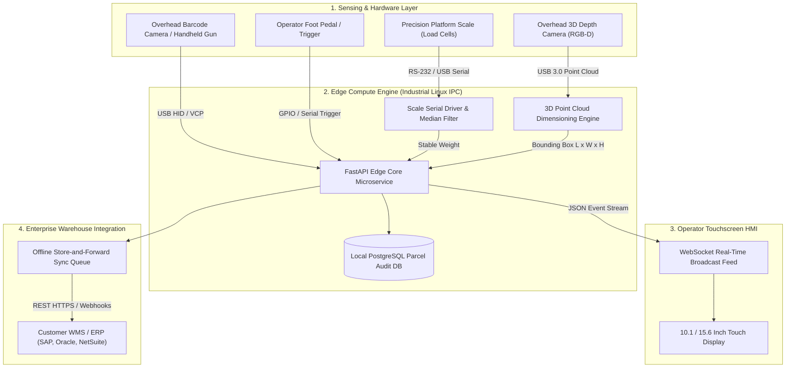
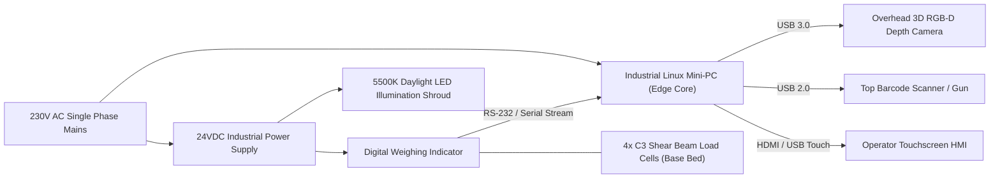
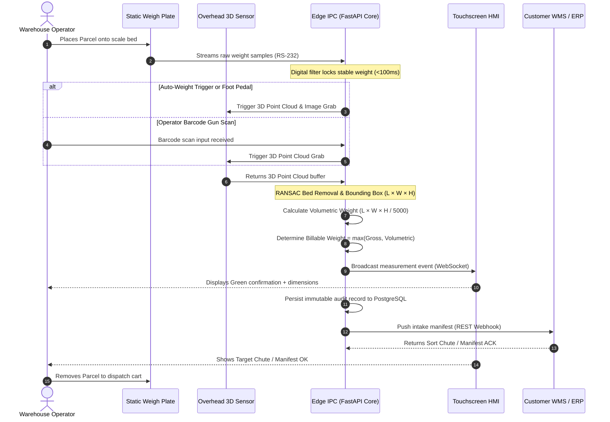

# YANTRIK DWS-S01 MASTER SYSTEM ARCHITECTURE (STATIC WORKSTATION)

```yaml
---
document_id: YAN-DOC-0031
title: Master System Architecture and Technical Topology — YANTRIK DWS-S01 Static
category: Engineering Architecture / System Design
repository_path: products/dws/ARCHITECTURE.md
version: 1.1.0
status: Approved
approval_level: L3 (Executive Strategy)
author: Central Intelligence / AGT-L1-CTO (Chief Technology Agent)
approved_by: Approved by Founder Directive
effective_date: 2026-11-06
dependencies:
  - company/identity/CONSTITUTION.md
  - products/dws/PRD.md
  - products/dws/METROLOGY_COMPLIANCE.md
validation_checklist:
  - "[x] Maps physical hardware, sensing mast, vision pipeline, and edge software for static machine"
  - "[x] Defines end-to-end parcel processing lifecycle using Mermaid diagrams"
  - "[x] Details serial weigh scale, USB camera, WebSocket HMI, and REST integration layers"
  - "[x] Documents fail-safe states and offline store-and-forward boundaries"
---
```

---

## 1. ARCHITECTURAL OVERVIEW & TOPOLOGY

The **YANTRIK DWS-S01** is a high-speed, compact industrial Static Dimensioning, Weighing, and Scanning workstation. It eliminates mechanical conveyor complexity by integrating an overhead 3D optical gantry, a precision industrial weighing plate, and an industrial Linux edge computer running local computer vision and real-time operator interfaces.



---

## 2. HARDWARE CABLING & INTERFACE TOPOLOGY



---

## 3. REAL-TIME STATIC MEASUREMENT SEQUENCE



---

## 4. REAL-TIME LATENCY BUDGET (<800ms STATIC CYCLE)

On the static workstation, the entire automated cycle executes in **under $800\text{ms}$** from parcel placement to visual HMI confirmation:

```mermaid
gantt
    title Static DWS Parcel Measurement Latency Budget
    dateFormat X
    axisFormat %s ms

    section Weighing
    Load Cell Mechanical Settling      :a1, 0, 200
    Digital Noise Filtering           :a2, 200, 250

    section Computer Vision
    RGB-D Frame Capture               :b1, 200, 320
    RANSAC Bed Removal & Bounding Box :b2, 320, 420
    Barcode Decoding                  :b3, 320, 400

    section Consolidation
    Weight Consolidation & Vol Weight :c1, 420, 450
    Local PostgreSQL DB Persist       :c2, 450, 480
    WebSocket HMI Screen Render       :c3, 480, 520
    Outbound WMS HTTP Post Push       :c4, 520, 750
```



---

## 4. SOFTWARE SUBSYSTEM ARCHITECTURE

### 4.1 Asynchronous Event Orchestrator (`services/event_orchestrator.py`)
- Coordinates the asynchronous pipeline using Python's `asyncio` event loop.
- Consumes inputs from independent producer queues:
  - `plc_queue`: State triggers from conveyor optical sensors.
  - `scale_queue`: Streaming digital weight strings with timestamp buffers.
  - `vision_queue`: 3D bounding box dimension structures.
  - `barcode_queue`: Decoded string payloads.
- Emits atomic, validated `ParcelEvent` instances to the database and external API pushers.

### 4.2 Fail-Safe State & Error Isolation
- **Hardware Decoupling:** In the event of an edge PC operating system crash or reboot, the physical PLC continues conveyor motor motion safely under local photoelectric interlocks, automatically diverting unscanned parcels to a manual exception lane.
- **Network Decoupling (Store-and-Forward):** If the warehouse enterprise network or cloud WMS disconnects, local PostgreSQL tables retain up to 5,000,000 un-synced parcel records. An asynchronous worker retries delivery using exponential backoff with jitter once network connectivity is restored.
