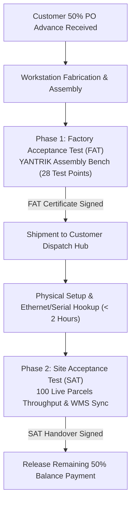
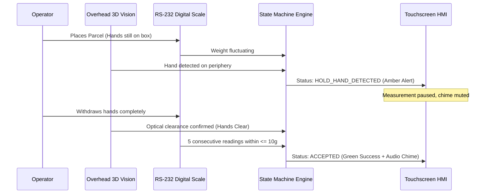

# YANTRIK DWS-S01 FACTORY & SITE ACCEPTANCE TEST (FAT / SAT) PROTOCOL

```yaml
---
document_id: YAN-DOC-0042
title: Factory Acceptance Test (FAT) & Site Acceptance Test (SAT) Verification Protocol — YANTRIK DWS-S01
category: Quality & Testing / Acceptance Protocols
repository_path: products/dws/testing/FAT_SAT_ACCEPTANCE_PROTOCOL.md
version: 1.0.0
status: Approved
approval_level: L2 (Technical Architecture)
author: Central Intelligence / AGT-D10-FAT01 (Industrial Acceptance Lead) & AGT-D10-DIR (QA Director)
approved_by: Approved by Founder Directive
effective_date: 2026-11-07
dependencies:
  - products/dws/PRD.md
  - products/dws/METROLOGY_COMPLIANCE.md
  - business/finance/CONTRACT_TEMPLATE.md
validation_checklist:
  - "[x] Details 10-point dimension calibration matrix with certified gauge blocks"
  - "[x] Details 5-point scale test with certified OIML Class M1 weights"
  - "[x] Validates Founder Hands-Off optical clearance and 5-sample weight stability"
  - "[x] Provides formal commercial sign-off certificates for FAT and SAT"
---
```

---

## 1. ACCEPTANCE PROTOCOL MANDATE

This protocol defines the formal, legally binding verification procedures governing the **YANTRIK DWS-S01 Static Workstation**. It serves as Annexure B to the Master Commercial Pilot Contract ([`business/finance/CONTRACT_TEMPLATE.md`](file:///home/snyder/yantrik/business/finance/CONTRACT_TEMPLATE.md)).



---

## 2. PHASE 1: FACTORY ACCEPTANCE TEST (FAT) SPECIFICATION

The FAT is executed on the YANTRIK assembly bench under Founder supervision prior to crating and logistics dispatch.

### 2.1 Dimensional Verification (OIML R129 Compliance)
Using certified aluminium/steel gauge blocks with NABL-traceable calibration:

| Test Point | Test Target ($\text{L} \times \text{W} \times \text{H}$ mm) | Expected Volume ($\text{cm}^3$) | Maximum Permissible Error (MPE) | Test Outcome |
| :---: | :---: | :---: | :---: | :---: |
| **FAT-DIM-01** | $100 \times 100 \times 50$ (Minimum Envelope) | $500$ | $\pm 5\text{mm}$ ($\pm 0.5\text{cm}$) | [ ] PASS / [ ] FAIL |
| **FAT-DIM-02** | $200 \times 150 \times 100$ (Standard Small) | $3,000$ | $\pm 5\text{mm}$ | [ ] PASS / [ ] FAIL |
| **FAT-DIM-03** | $300 \times 200 \times 150$ (Medium Box) | $9,000$ | $\pm 5\text{mm}$ | [ ] PASS / [ ] FAIL |
| **FAT-DIM-04** | $400 \times 300 \times 200$ (Standard Courier Box) | $24,000$ | $\pm 5\text{mm}$ | [ ] PASS / [ ] FAIL |
| **FAT-DIM-05** | $500 \times 400 \times 300$ (Heavy Dispatch Crate) | $60,000$ | $\pm 5\text{mm}$ | [ ] PASS / [ ] FAIL |
| **FAT-DIM-06** | $600 \times 400 \times 400$ (Bulky E-Commerce) | $96,000$ | $\pm 5\text{mm}$ | [ ] PASS / [ ] FAIL |
| **FAT-DIM-07** | $800 \times 600 \times 600$ (Maximum Envelope) | $288,000$ | $\pm 5\text{mm}$ | [ ] PASS / [ ] FAIL |
| **FAT-DIM-08** | $400 \times 300 \times 200$ Rotated at $45^\circ$ | $24,000$ | $\pm 5\text{mm}$ (OBB Check) | [ ] PASS / [ ] FAIL |
| **FAT-DIM-09** | $400 \times 300 \times 200$ Placed at Platter Corner | $24,000$ | $\pm 5\text{mm}$ (Eccentric Check) | [ ] PASS / [ ] FAIL |
| **FAT-DIM-10** | Irregular Cylindrical/Polybag Sample | Certified Caliper Ref | $\pm 10\text{mm}$ (Irregular Mode) | [ ] PASS / [ ] FAIL |

### 2.2 Scale Weight Calibration (OIML R51 Class III)
Using certified OIML Class M1 cast iron test weights:

| Test Point | Applied Standard Weight | Scale Indicator Reading | Allowable MPE | 5-Sample Fluctuation ($\le 10\text{g}$) | Status |
| :---: | :---: | :---: | :---: | :---: | :---: |
| **FAT-WT-01** | $0.500\text{ kg}$ (Minimum Load) | ________ kg | $\pm 10\text{ g}$ | $\le 10\text{ g}$ | [ ] PASS |
| **FAT-WT-02** | $5.000\text{ kg}$ (Quarter Load) | ________ kg | $\pm 10\text{ g}$ | $\le 10\text{ g}$ | [ ] PASS |
| **FAT-WT-03** | $15.000\text{ kg}$ (Half Load) | ________ kg | $\pm 15\text{ g}$ | $\le 10\text{ g}$ | [ ] PASS |
| **FAT-WT-04** | $30.000\text{ kg}$ (Three-Quarter Load)| ________ kg | $\pm 20\text{ g}$ | $\le 10\text{ g}$ | [ ] PASS |
| **FAT-WT-05** | $60.000\text{ kg}$ (Full Scale Range) | ________ kg | $\pm 20\text{ g}$ | $\le 10\text{ g}$ | [ ] PASS |
| **FAT-WT-06** | Eccentricity: $15\text{kg}$ at Platter 4 Corners | ________ kg | $\pm 15\text{ g}$ | $\le 10\text{ g}$ | [ ] PASS |

### 2.3 Founder Hands-Off & Auto-Scan Safety Gating



- **FAT-SAF-01 (Hand Touch Hold):** Operator places hand on parcel. Verified that state machine displays `HOLD_HAND_DETECTED` and inhibits final capture.
- **FAT-SAF-02 (Hands-Off Trigger):** Operator releases parcel. Verified that system locks measurement within $< 1.5\text{ seconds}$ once weight variance $\le 10\text{g}$.
- **FAT-SAF-03 (Audio & Visual Feedback):** Verified that successful scans emit high-frequency confirmation chime and update live recovered revenue display.

---

## 3. PHASE 2: SITE ACCEPTANCE TEST (SAT) SPECIFICATION

The SAT is executed directly at the client's booking or distribution hub on live customer freight:

### 3.1 Live 100-Parcel Stress Throughput Benchmark
- **Test Execution:** 100 consecutive commercial parcels processed across standard operation.
- **Throughput SLA:** Average total cycle time $\le 2.0\text{ seconds}$ per parcel ($> 600\text{ PPH}$ capacity).
- **Barcode Decoding Rate:** $\ge 99.0\%$ first-pass read rate on Code 128, QR, DataMatrix, and PDF417 labels.
- **Volumetric Accuracy:** Volumetric weight calculated exactly as:
  $$\text{Volumetric Weight (kg)} = \frac{\text{Length (cm)} \times \text{Width (cm)} \times \text{Height (cm)}}{5000}$$
- **Data Integrity:** 100/100 scans recorded into local SQLite WAL database with zero record drops.
- **WMS Integration:** Real-time dispatch of JSON webhook payload to client ERP/WMS with certified dimensions, weight, and barcode.

---

## 4. FORMAL ACCEPTANCE CERTIFICATES

### 4.1 Factory Acceptance Test (FAT) Sign-off Certificate

```
================================================================================
                    YANTRIK FACTORY ACCEPTANCE CERTIFICATE
================================================================================
Machine Model:    YANTRIK DWS-S01 (Static Workstation)
Serial Number:    YAN-DWS-2026-S01-__________
Customer Name:    ______________________________________________________________
FAT Location:     YANTRIK Manufacturing Assembly Bench
Date of Test:     ____________________

Verification Summary:
  [ ] 10-Point Dimensioning Matrix:   PASSED (All within +/- 5mm MPE)
  [ ] 5-Point Class M1 Scale Test:    PASSED (All within OIML R51 Class III)
  [ ] Optical Hands-Off Gating:       PASSED (HOLD_HAND_DETECTED operational)
  [ ] 5-Sample Weight Stability:      PASSED (Fluctuation <= 10g locked)
  [ ] Embedded Edge Server & HMI:     PASSED (Zero-dependency localhost:8000)

We hereby certify that the machine above has successfully passed all Factory
Acceptance Tests and is authorized for crating and customer site shipment.

YANTRIK Quality Authority:          Customer Representative (Optional):
Signature: ______________________    Signature: ______________________
Date:      ______________________    Date:      ______________________
================================================================================
```

### 4.2 Site Acceptance Test (SAT) Sign-off Certificate

```
================================================================================
                     YANTRIK SITE ACCEPTANCE CERTIFICATE
================================================================================
Machine Model:    YANTRIK DWS-S01 (Static Workstation)
Serial Number:    YAN-DWS-2026-S01-__________
Customer Site:    ______________________________________________________________
Installation Date:____________________

Verification Summary:
  [ ] Live 100-Parcel Throughput:     PASSED (Average cycle < 2.0s)
  [ ] Barcode Read Rate:              PASSED (> 99.0% first-pass read)
  [ ] SQLite WAL Local Ledger:        PASSED (Zero data loss, 100% audit log)
  [ ] WMS Webhook Synchronization:    PASSED (JSON payload delivered)
  [ ] Operator Staff Training:        PASSED (3 Operators certified)

The Customer hereby accepts delivery and operational commissioning of the
YANTRIK DWS-S01 workstation. This document triggers release of the remaining
50% balance payment per the Master Commercial Agreement.

Customer Authorized Officer:        YANTRIK Founder / Commissioning Lead:
Name:      ______________________    Name:      ______________________
Title:     ______________________    Title:     Human Founder
Signature: ______________________    Signature: ______________________
Date:      ______________________    Date:      ______________________
================================================================================
```
