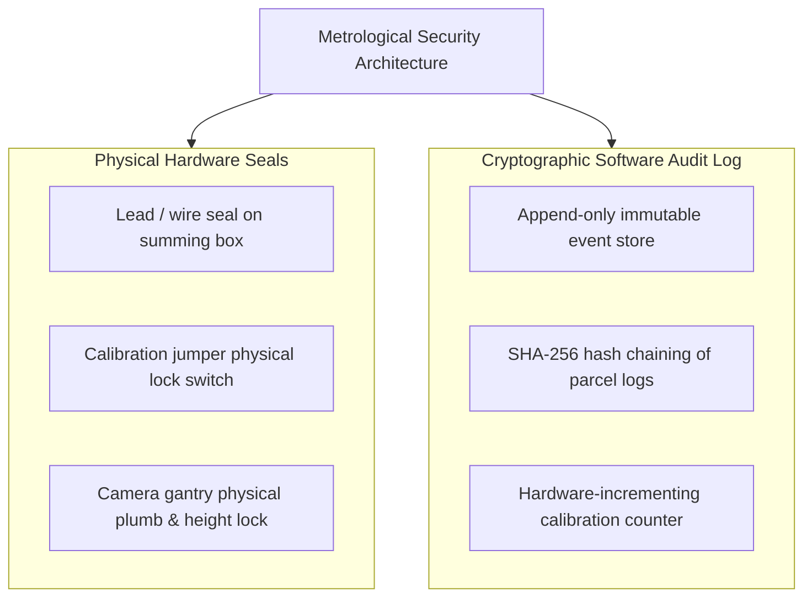

# YANTRIK DWS-S01 LEGAL METROLOGY & REGULATORY COMPLIANCE

```yaml
---
document_id: YAN-DOC-0030
title: Legal Metrology, Metrological Verification, and Regulatory Standards — YANTRIK DWS-S01
category: Engineering Standards / Metrology
repository_path: products/dws/METROLOGY_COMPLIANCE.md
version: 1.1.0
status: Approved
approval_level: L3 (Executive Strategy)
author: Central Intelligence / AGT-D10-FAT01 (Metrology Lead)
approved_by: Approved by Founder Directive
effective_date: 2026-11-06
dependencies:
  - company/identity/CONSTITUTION.md
  - products/dws/PRD.md
validation_checklist:
  - "[x] Details OIML R51 (Automatic Catchweighing Instruments) compliance standards"
  - "[x] Details OIML R129 (Multi-dimensional Measuring Instruments) standards"
  - "[x] Specifies Maximum Permissible Error (MPE) thresholds for commercial billing"
  - "[x] Mandates tamper-evident software audit logs and calibration seals"
---
```

---

## 1. REGULATORY FRAMEWORK & PURPOSE

In commercial logistics, freight forwarding, and e-commerce, parcel dimensions and weights directly determine shipping tariffs and freight billing. Under national and international law (e.g. **The Legal Metrology Act, 2009** in India and international **OIML recommendations**), automated instruments used for commercial billing must satisfy strict metrological standards, periodic stamping, and tamper-proof audit trails.

The **YANTRIK DWS-01** is engineered to meet or exceed:
- **OIML R51:** Automatic Catchweighing Instruments (Class III / Category X/Y).
- **OIML R129:** Multi-dimensional Measuring Instruments.
- **IS 9281 (Part 3):** Indian Standard for Electronic Weighing Systems.

---

## 2. MAXIMUM PERMISSIBLE ERROR (MPE) STANDARDS

### 2.1 Gravimetric (Weighing) Standards — OIML R51 Class III
For a verification scale interval $e = 10\text{g}$ (Static) and $e = 20\text{g}$ (Dynamic):

| Load Range ($m$) | Maximum Permissible Error (Initial Verification) | In-Service Inspection MPE |
| :--- | :---: | :---: |
| $0 \le m \le 500\,e$ ($0\text{ to }5\text{kg}$) | $\pm 0.5\,e$ ($\pm 5\text{g}$) | $\pm 1.0\,e$ ($\pm 10\text{g}$) |
| $500\,e < m \le 2000\,e$ ($5\text{ to }20\text{kg}$) | $\pm 1.0\,e$ ($\pm 10\text{g}$) | $\pm 2.0\,e$ ($\pm 20\text{g}$) |
| $2000\,e < m \le 3000\,e$ ($20\text{ to }50\text{kg}$) | $\pm 1.5\,e$ ($\pm 15\text{g}$) | $\pm 3.0\,e$ ($\pm 30\text{g}$) |

*Dynamic Weighing Tolerance:* On in-line dynamic conveyor models running at $1.5\text{ m/s}$, the maximum permissible error is $\pm 20\text{g}$ for parcels $\le 10\text{kg}$ and $\pm 50\text{g}$ for parcels $> 10\text{kg}$.

### 2.2 Volumetric (Dimensional) Standards — OIML R129
For automated multi-dimensional measuring instruments with scale interval $d = 5\text{mm}$:

| Dimension Range ($L, W, H$) | Target Calibration Accuracy | In-Service Permissible Error |
| :--- | :---: | :---: |
| **Cuboidal / Rigid Boxes** | $\pm 2\text{mm}$ | $\pm 5\text{mm}$ |
| **Irregular Parcels / Polybags** | $\pm 5\text{mm}$ | $\pm 10\text{mm}$ |

---

## 3. AUDIT TRAILS & TAMPER-EVIDENT ARCHITECTURE

To comply with legal weights & measures regulations, YANTRIK DWS-01 enforces hard security controls preventing unauthorized alteration of calibration factors or measurement logs:



1. **Hardware Calibration Jumper:** Physical calibration switches on the weighing indicator summing board are enclosed inside a die-cast aluminum enclosure secured by physical tamper-evident inspection wire seals.
2. **Cryptographic Software Audit Trail:** Every calibration event (zero calibration, span calibration, camera extrinsic matrix update) increments an immutable software **Calibration Counter** and writes an entry to an append-only cryptographic log signed by the operator's digital credentials.
3. **Raw Optical Audit Capture:** For every measured parcel, YANTRIK stores the unedited, timestamped RGB-D image and raw sensor values alongside the calculated dimensions. In shipping weight dispute claims, the customer can instantly produce empirical visual proof of the package state on the scale.

---

## 4. PERIODIC VERIFICATION & FIELD CALIBRATION RUNBOOK

Every deployed YANTRIK DWS machine follows a mandatory calibration and verification schedule:
1. **Daily Auto-Zero Routine:** Machine automatically zeros the scale bed during conveyor gaps; if zero drift exceeds $\pm 20\text{g}$, an operator warning is triggered on the HMI.
2. **Weekly Reference Cuboid Scan:** Certified steel or precision acrylic reference cuboid ($300 \times 200 \times 150\text{mm}$) is scanned; calibration verified against baseline.
3. **Annual Legal Metrology Stamping:** Machine re-verified using certified Class $M_1$ test weights in the presence of authorized regulatory inspectors.
