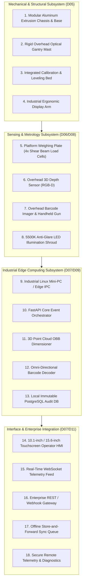

# YANTRIK DWS-S01 PRODUCT REQUIREMENTS DOCUMENT (PRD)

```yaml
---
document_id: YAN-DOC-0029
title: Product Requirements Document (PRD) — YANTRIK DWS-S01 Static Workstation
category: Product Management / PRD
repository_path: products/dws/PRD.md
version: 1.1.0
status: Approved
approval_level: L3 (Executive Strategy)
author: Central Intelligence / AGT-D03-PM01 (Product Manager)
approved_by: Approved by Founder Directive
effective_date: 2026-11-06
dependencies:
  - company/identity/CONSTITUTION.md
  - company/identity/PROFILE.md
  - projects/active/PRJ-DWS-01/CHARTER.md
validation_checklist:
  - "[x] Details functional and non-functional requirements for both Static and Dynamic tiers"
  - "[x] Defines quantitative measurement envelopes, accuracy thresholds, and cycle times"
  - "[x] Specifies hardware sub-assemblies, operator touch HMI, and WMS integration APIs"
  - "[x] Aligns with Legal Metrology standards (OIML R51 / R129)"
---
```

---

## 1. PRODUCT OVERVIEW & VALUE PROPOSITION

The **YANTRIK DWS-01** is an industrial Dimensioning, Weighing, and Scanning (DWS) automation system designed for logistics distribution centers, express parcel courier branches, e-commerce fulfillment hubs, and freight forwarding terminals.

### The Commercial Problem:
Logistics companies suffer $8\%\text{ to }14\%$ revenue leakage because shippers declare minimum dead-weight while actual volumetric billing weight ($\text{Length} \times \text{Width} \times \text{Height} / 5000$) is much higher. Manual tape measuring and scales are slow ($200\text{--}300\text{ PPH}$), prone to fraud, and labor-intensive. Legacy imported dynamic DWS machines cost ₹18,00,000–₹35,00,000+, with proprietary locked hardware and poor domestic field support.

### The YANTRIK Solution:
An open-architecture, vision-AI powered, serviceable industrial system manufactured at a fraction of imported costs:
- **Tier 1 (Static Tabletop Workstation):** ₹1,80,000–₹2,50,000 retail price ($~600\text{ PPH}$).
- **Tier 2 (Dynamic In-line Conveyor):** ₹7,50,000–₹10,50,000 retail price ($3,000+\text{ PPH}$).

---

## 2. SYSTEM CAPABILITY & METROLOGICAL METRICS

| Performance Parameter | Tier 1: Static Workstation | Tier 2: Dynamic In-line Conveyor |
| :--- | :--- | :--- |
| **Operational Mode** | Manual Placement on Scale Plate | Continuous Belt Conveyance |
| **Conveyor Speed** | N/A (Static) | $0.8\text{ m/s}$ to $1.8\text{ m/s}$ (Variable VFD) |
| **Target Throughput** | $500\text{ -- }700\text{ parcels/hour}$ | $2,500\text{ -- }3,500\text{ parcels/hour}$ |
| **Minimum Dimension** | $50 \times 50 \times 20\text{ mm}$ | $100 \times 100 \times 30\text{ mm}$ |
| **Maximum Dimension** | $800 \times 600 \times 600\text{ mm}$ | $1000 \times 800 \times 800\text{ mm}$ |
| **Dimension Accuracy (Cuboid)** | $\pm 5\text{ mm}$ ($\pm 2\text{ mm}$ target) | $\pm 5\text{ mm}$ |
| **Dimension Accuracy (Irregular)**| $\pm 10\text{ mm}$ (Convex hull bounding box)| $\pm 10\text{ mm}$ |
| **Weight Capacity** | $50\text{g}$ to $50\text{kg}$ | $100\text{g}$ to $60\text{kg}$ |
| **Weight Accuracy** | $\pm 10\text{g}$ (Legal Metrology Class III) | $\pm 20\text{g}$ ($\le 10\text{kg}$); $\pm 50\text{g}$ ($> 10\text{kg}$) |
| **Barcode Read Rate** | $\ge 99.8\%$ (Manual presentation) | $\ge 99.5\%$ (Top + front/side camera tunnel) |
| **Barcode Formats** | 1D: Code 128, Code 39, EAN, ITF-14; 2D: QR, Data Matrix, PDF417 | 1D & 2D Omni-directional |
| **Cycle Latency** | $< 800\text{ms}$ total cycle | $< 120\text{ms}$ per parcel pass |
| **Data Retention** | Local SSD: 1,000,000 parcel records + audit photos | Local SSD: 5,000,000 records |

---

## 3. CORE HARDWARE & SOFTWARE MODULES



### Module Specifications:
1. **Chassis & Structure (D05):**
   - High-grade welded mild steel box section base or modular $45 \times 45\text{mm}$ heavy anodized aluminum extrusion.
   - Vibration isolation feet decoupling plant floor vibrations from load cells.
   - Adjustable height: $750\text{mm} \pm 50\text{mm}$ (standard industrial conveyor datum).
2. **Weighing Assembly (D05/D06):**
   - Four high-precision C3/C4 alloy steel / aluminum shear beam load cells connected to a digital 24-bit summing transmitter.
   - Dynamic weigh-bed: Lightweight aluminum honeycomb or carbon-fiber composite bed minimizing tare inertia.
3. **Vision & Optical Gantry (D05/D08):**
   - Rigid overhead tower ($1200\text{mm}$ above bed) isolating overhead camera from motor vibration.
   - Integrated anti-flicker LED illumination bar ($5500\text{K}$ daylight balance).
4. **Electrical Panel & PLC (D06):**
   - Industrial IP54 control cabinet with DIN-rail circuit breakers, 24VDC 10A power supply, and Siemens S7-1200 or Delta DVP PLC.
   - Dual-channel E-Stop safety relay (ISO 13849-1 Category 3, PL d).

---

## 4. SOFTWARE & USER EXPERIENCE SPECIFICATIONS

### 4.1 Operator Touchscreen HMI
- **Screen:** 10.1" to 15.6" capacitive industrial touch display mounted on articulated arm.
- **Color Theme:** High-contrast industrial dark mode matching YANTRIK brand guidelines.
- **Main Operational Screen:**
  - Live parcel status: Green (Accepted & Synced) / Yellow (Dimension Warning) / Red (Barcode Read Fail).
  - Prominent metrics: Length (cm), Width (cm), Height (cm), Gross Weight (kg), Volumetric Weight (kg).
  - Live camera overlay with detected bounding box wireframe and barcode text.
  - One-touch manual override buttons: Zero Scale, Tare, Re-scan, Manual Barcode Entry.

### 4.2 Edge Backend & APIs
- **Core Engine:** Python 3.11+ FastAPI asynchronous microservice running locally on Ubuntu Linux Edge IPC.
- **Database:** PostgreSQL storing immutable parcel logs (UUID, timestamp, dimensions, weight, barcode, operator ID, raw image paths).
- **Store-and-Forward Engine:** Local queue caching records during warehouse internet dropouts, automatically re-synchronizing when connectivity restores.
- **Outbound WMS Connectors:** Configurable JSON HTTP POST webhooks, WebSocket live broadcast, and CSV scheduled exports.

---

## 5. ENVIRONMENTAL & NON-FUNCTIONAL REQUIREMENTS

- **Power Supply:** $220\text{V} \pm 10\%\text{ AC}, 50\text{Hz}$ single-phase (conveyor motor 3-phase powered via VFD).
- **Power Consumption:** Static Workstation: $< 250\text{W}$; Dynamic Conveyor: $< 1.2\text{kW}$.
- **Acoustic Noise:** $< 68\text{ dB(A)}$ at $1\text{ meter}$ operator distance.
- **Mean Time Between Failures (MTBF):** $\ge 10,000\text{ operating hours}$.
- **Mean Time to Repair (MTTR):** $< 30\text{ minutes}$ for consumable wear parts (belts, sensors).
